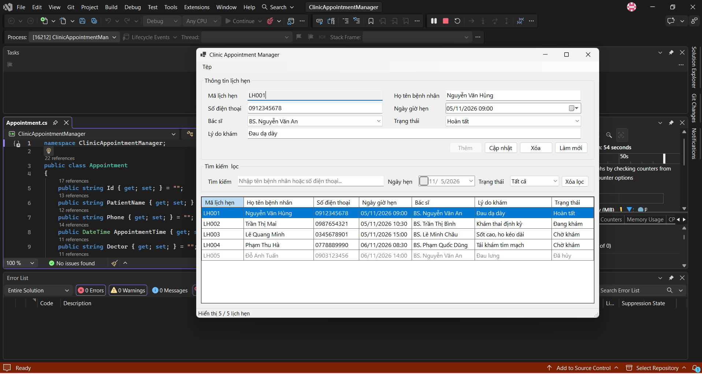
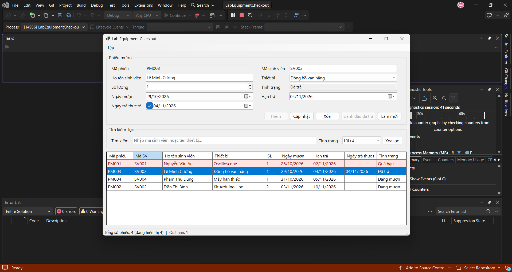
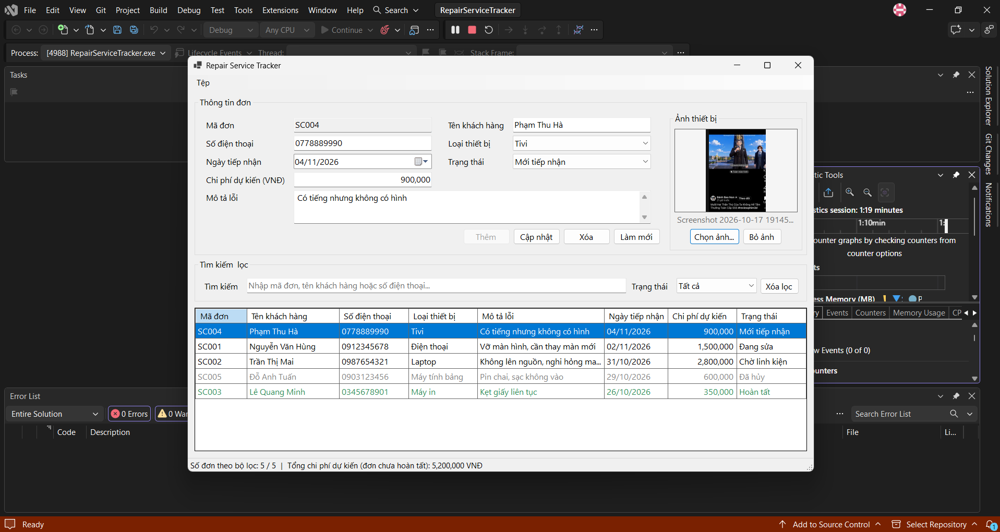

# BÁO CÁO BÀI TẬP / ĐỒ ÁN

## THÔNG TIN SINH VIÊN
- **Họ và tên:** Dương Ngô Hạnh
- **Mã số sinh viên:** 24810310206
- **Lớp:** D19-CNPM3
- **Tên môn học:** Lập trình C# / Windows Forms

---

## KẾT QUẢ THỰC HÀNH

### Bài tập 1: Quản lý lịch hẹn phòng khám (Clinic Appointment Manager)

*Hình 1. Giao diện chính: khu vực nhập thông tin lịch hẹn, tìm kiếm/lọc theo ngày và trạng thái, `DataGridView` hiển thị 5 lịch hẹn. Dòng LH001 đang được chọn nên dữ liệu được nạp lên form; thanh trạng thái hiển thị "Hiển thị 5 / 5 lịch hẹn".*

---

### Bài tập 2: Quản lý mượn trả thiết bị tại phòng thực hành (Lab Equipment Checkout)

*Hình 2. Phiếu PM003 đã được đánh dấu "Đã trả" với ngày trả thực tế 04/11/2026. Phiếu PM001 chưa trả và có hạn trả đã qua nên được nhận diện là "Quá hạn" (tô nền hồng). Thanh trạng thái hiển thị "Tổng số phiếu: 4 (đang hiển thị 4) | Quá hạn: 1".*

---

### Bài tập 3: Quản lý đơn đăng ký dịch vụ sửa chữa (Repair Service Tracker)

*Hình 3. Đơn SC004 được chọn và nạp lên form, ảnh thiết bị hiển thị trong `PictureBox` (chế độ Zoom, giữ đúng tỷ lệ). Cột chi phí định dạng `N0`; thanh trạng thái hiển thị "Số đơn theo bộ lọc: 5 / 5" và tổng chi phí dự kiến của các đơn chưa hoàn tất là 5,200,000 VNĐ.*

---

## KIỂM TRA DỮ LIỆU (VALIDATION)

<!-- Chèn ảnh chụp ErrorProvider (biểu tượng lỗi đỏ cạnh trường nhập sai) cho từng bài tại đây, ví dụ:

-->
