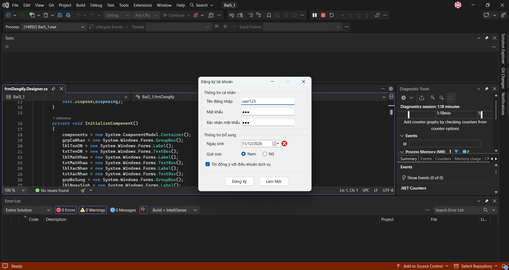
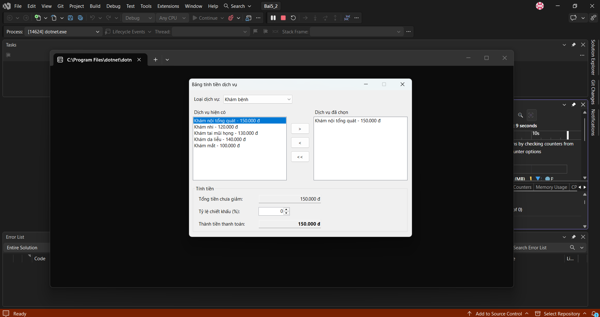
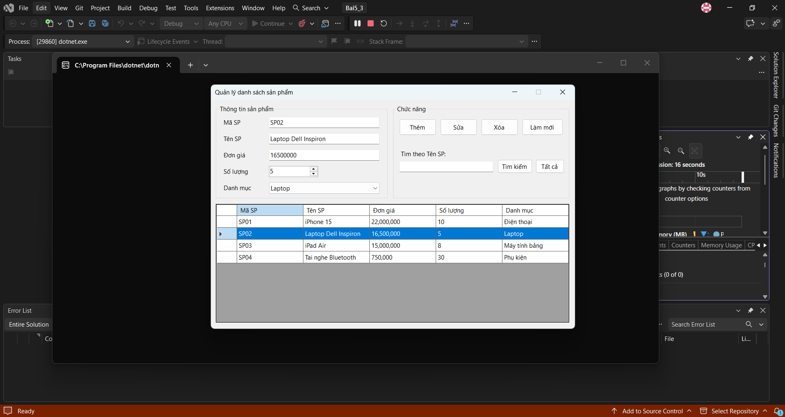
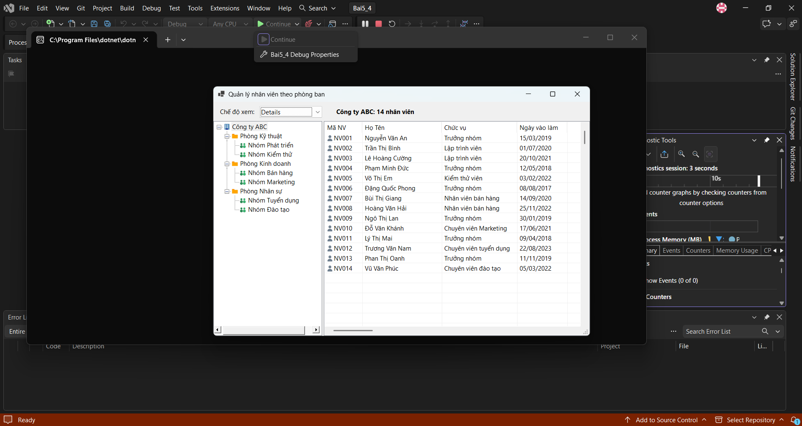

# BÁO CÁO BÀI TẬP / ĐỒ ÁN

## THÔNG TIN SINH VIÊN
- **Họ và tên:** Dương Ngô Hạnh
- **Mã số sinh viên:** 24810310206
- **Lớp:** D19-CNPM3
- **Tên môn học:** Lập trình C# / Windows Forms
- **Tên bài tập:** bài tập thực hành 12/11/2026

---

## KẾT QUẢ THỰC HÀNH

### 1. Ảnh màn hình Giao diện chính

**Bài 5.1 – Đăng ký tài khoản**

**Bài 5.2 – Bảng tính tiền dịch vụ**

**Bài 5.3 – Quản lý danh sách sản phẩm**

**Bài 5.4 – Quản lý nhân viên theo phòng ban**

