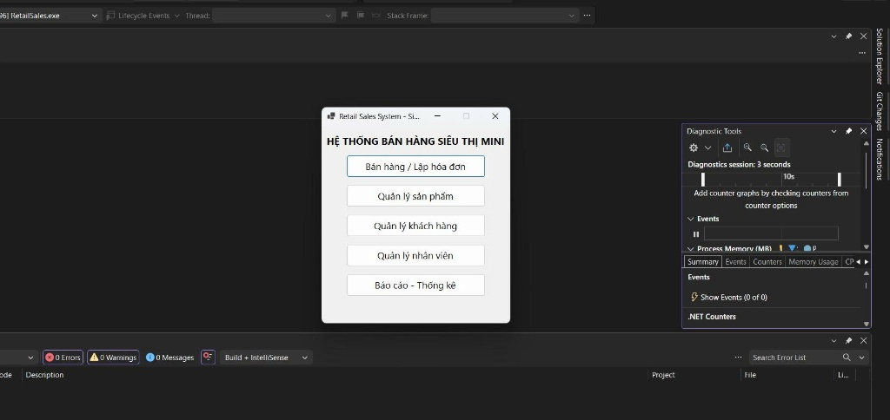

# BÁO CÁO ĐỒ ÁN MÔN HỌC

## MỤC 1: THÔNG TIN SINH VIÊN
* **Họ và tên sinh viên:** [Điền họ tên của bạn]
* **Mã sinh viên:** [Điền mã sinh viên]
* **Lớp / Khóa:** [Điền tên lớp / khóa]
* **Tên đề tài:** [Điền tên đề tài, ví dụ: Hệ thống Bán hàng Siêu thị Mini / Quản lý Nhân sự Tính lương]

---

## MỤC 2: HÌNH ẢNH KẾT QUẢ CÁC MÀN HÌNH CHỨC NĂNG

### 1. Màn hình Chính / Tổng quan hệ thống
Giao diện điều hướng chính của hệ thống cho phép truy cập nhanh vào các phân hệ chức năng.

### 2. Màn hình Quản lý Danh mục (CRUD - Thêm/Sửa/Xóa)
Chức năng quản lý dữ liệu danh mục (Thêm mới, Cập nhật, Xóa và Tìm kiếm thông tin).

### 3. Màn hình Thực thi Nghiệp vụ chính
Giao diện xử lý nghiệp vụ cốt lõi của hệ thống (Bán hàng - Lập hóa đơn / Chấm công tháng).

### 4. Màn hình Báo cáo - Thống kê
Tổng hợp số liệu doanh thu, tồn kho hoặc bảng tính lương chi tiết theo kỳ.

### 5. Minh họa An toàn Dữ liệu (SQL Injection & Transaction Rollback)
Hệ thống sử dụng `SqlParameter` (Parameterized Query) để ngăn chặn tấn công SQL Injection và cơ chế `SqlTransaction` để đảm bảo toàn vẹn dữ liệu (tự động Rollback khi phát sinh lỗi).

