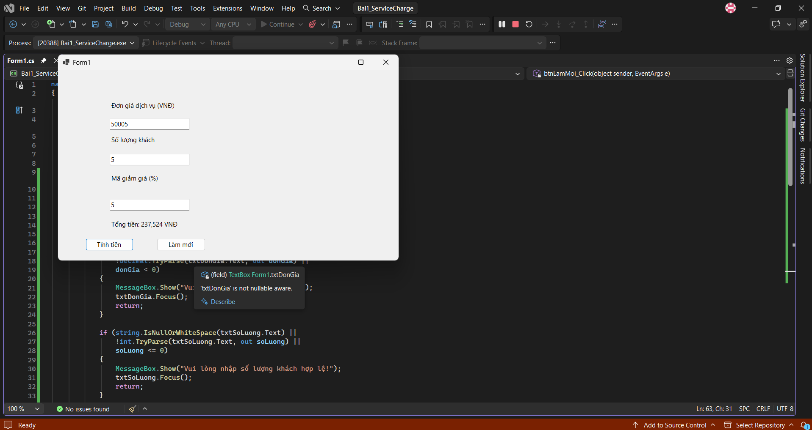
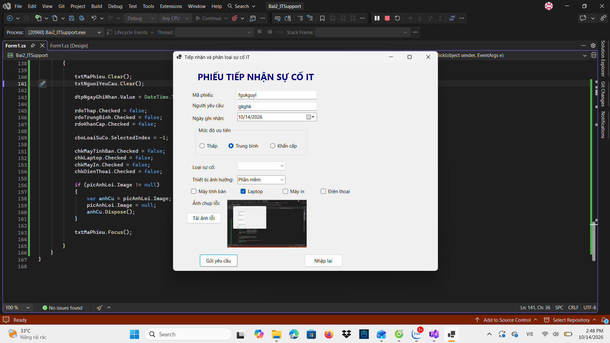
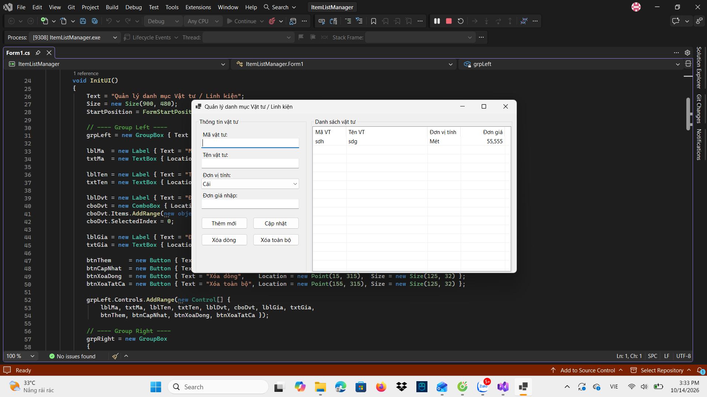

# BÁO CÁO BÀI TẬP WINDOWS FORMS C#

## THÔNG TIN SINH VIÊN

- **Họ và tên:** Dương Ngô Hạnh
- **Mã số sinh viên:** 24810310206
- **Lớp:** D19-CNPM3
- **Trường:** Đại học Điện lực (EPU)
- **Tên môn học:** Lập trình C# / Windows Forms
- **Tên bài tập:** Ôn tập Windows Forms

---

## KẾT QUẢ THỰC HÀNH

### 1. Bài 1: Máy tính tính cước dịch vụ và giảm giá



### 2. Bài 2: Phiếu tiếp nhận và phân loại sự cố IT



### 3. Bài 3: Quản lý danh mục vật tư / linh kiện



---

## CÔNG NGHỆ SỬ DỤNG

- **Ngôn ngữ:** C#
- **Giao diện:** Windows Forms
- **Môi trường phát triển:** Visual Studio
- **Quản lý mã nguồn:** Git và GitHub

---

## CẤU TRÚC THƯ MỤC

```text
README_WindowsForms/
├── README.md
└── screenshots/
    ├── bai1_service_charge.png
    ├── bai2_it_support.png
    └── bai3_item_list_manager.png
```

## KẾT LUẬN

Bài thực hành giúp củng cố kỹ năng xây dựng giao diện Windows Forms, xử lý sự kiện và kiểm tra dữ liệu nhập, đồng thời thực hành quản lý danh sách vật tư / linh kiện.

